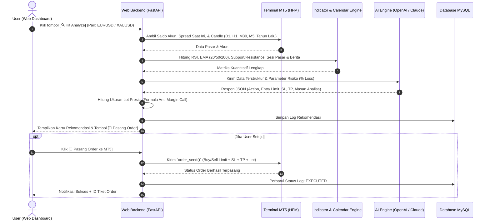

# 📑 Rencana Pengembangan: AI Trading Copilot (HFM MT5 + Web UI)

Dokumen ini berisi spesifikasi teknis, arsitektur sistem, skema basis data, dan tahapan implementasi untuk bot asisten trading semi-otomatis berbasis web, bertenaga LLM (OpenAI / Claude), dan terhubung langsung ke broker HFM via MetaTrader 5 (MT5).

---

## 1. Ikhtisar Sistem & Alur Pengguna (Semi-Automated Workflow)

Sistem bekerja dengan prinsip **Human-in-the-Loop** (tidak ada eksekusi otomatis tanpa persetujuan trader):



---

## 2. Parameter Analisa & Logika Kuantitatif

### 2.1 Multi-Timeframe Analysis (MTFA) & Seasonality
* **Daily (D1):** Menentukan arah tren makro (di atas/bawah EMA 200) dan zona Support/Resistance kunci harian.
* **M30 - H1 (Main Setup):** Timeframe utama pencarian setup (struktur pasar, kondisi overbought/oversold pada RSI, dan persilangan EMA 20/50).
* **M5 (Precision Trigger):** Mencari konfirmasi candle rejection atau pembentukan struktur mikro untuk titik *entry limit* yang presisi.
* **Historical Seasonality (Tanggal Sama Tahun Lalu):** Menarik 100 candle pada tanggal dan bulan yang sama di 1–2 tahun sebelumnya untuk mengecek bias musiman pasar.

### 2.2 Sesi Pasar (Session Timing) & Filter Berita
* **Sesi Aktif:** London (14.00 - 18.00 WIB) dan New York (19.00 - 23.00 WIB) menjadi jam prioritas analisa.
* **Economic Calendar Filter:** Mengintegrasikan kalender ekonomi. Jika terdeteksi berita berkategori *High Impact* (Red Folder seperti NFP, CPI, FOMC) dalam rentang 30 menit sebelum/sesudah waktu analisa, AI akan merekomendasikan status **WAIT / NO TRADE**.

### 2.3 Formula Anti-Margin Call & Buffer Spread HFM
* **Buffer Spread (1.4 Pips):**
  * Posisi **BUY:** Stop Loss ditempatkan pada level support dikurangi 1.4 pips + buffer volatilitas.
  * Posisi **SELL:** Entry limit dan Stop Loss disesuaikan dengan penambahan spread 1.4 pips agar tidak tersentuh prematurely.
* **Perhitungan Lot Otomatis:**
  $$\text{Nilai Uang Berisiko} = \text{Saldo Akun} \times \left(\frac{\text{Batas Maksimal Loss \%}}{100}\right)$$
  $$\text{Ukuran Lot} = \frac{\text{Nilai Uang Berisiko}}{\text{Jarak Stop Loss (dalam Pips)} \times \text{Nilai Per Pip per Standard Lot}}$$
  > [!IMPORTANT]
  > Dengan metode ini, seandainya harga menyentuh Stop Loss, modal akun hanya akan berkurang tepat sebesar persentase yang Anda tetapkan (misal 1% atau 2%), sehingga **mustahil terjadi Margin Call**.

---

## 3. Peran AI / LLM (OpenAI / Claude)

LLM bertindak sebagai **Chief Technical Analyst**:
1. Menerima rekap data berupa:
   * Status tren D1, H1, M30, M5
   * Nilai RSI, posisi harga relatif terhadap EMA 20/50/200, dan level S/R
   * Bias historis tahun lalu
   * Jadwal berita terdekat dan sesi pasar yang sedang berjalan
2. Mengembalikan output dalam format **JSON Terstruktur**:
   ```json
   {
     "action": "BUY_LIMIT",
     "entry_price": 1.08450,
     "stop_loss": 1.08200,
     "take_profit": 1.08950,
     "risk_reward_ratio": "1:2.0",
     "confidence_score": 85,
     "analysis_summary": "Daily berada dalam tren Bullish di atas EMA 200. M30 mengalami pullback ke area Support di 1.0845 dengan RSI di level 34 (Oversold). Tidak ada berita High Impact dalam 2 jam ke depan.",
     "seasonality_note": "Pada tanggal yang sama tahun lalu, pair ini menunjukkan konsolidasi sebelum menguat di sesi New York."
   }
   ```

---

## 4. Konfigurasi Simbol & Sumber Berita

### 4.1 Konfigurasi Simbol / Komoditas (Lookup Whitelist & Suffix Mapping)
Di broker HFM, tipe akun berbeda memiliki penamaan simbol berbeda (misal Akun Cent berakhiran `c`, seperti `XAUUSDc`, `USDJPYc`, atau `EURUSDc`).
* **Sistem Whitelist:** Sistem hanya melakukan lookup dan menampilkan simbol-simbol yang didaftarkan pada konfigurasi.
* **Mapping Base Instrument:** 
  * Simbol MT5 `XAUUSDc` atau `XAUUSD` dipetakan ke Base Instrument `XAUUSD` (Gold).
  * Simbol MT5 `USDJPYc` dipetakan ke `USDJPY`.
  * Hal ini memastikan saat scraping berita dan kalender ekonomi, bot tetap mencari berita global yang relevan dengan instrumen dasarnya.

### 4.2 Konfigurasi Sumber Berita & Sentimen
Setiap sumber berita dapat diaktifkan/dinonaktifkan secara independen pada halaman pengaturan:
1. **Forex Factory Calendar (JSON Feed):** Gratis, tanpa API Key. Deteksi jadwal berita *High Impact* (Red Folder).
2. **ForexLive RSS:** Gratis, tanpa API Key. Breaking news & narasi mata uang secara *real-time*.
3. **Yahoo Finance (`yfinance`):** Gratis, tanpa API Key. Berita spesifik per ticker komoditas/mata uang.
4. **Google News RSS:** Gratis, tanpa API Key. Pencarian berita 24 jam terakhir berbasis kata kunci instrumen.
5. **MSN Money / Bing RSS:** Gratis, tanpa API Key. Sentimen pasar global.
6. **Finnhub / NewsAPI (Opsional):** Memerlukan API Key (disediakan kolom input API Key di halaman Settings jika user ingin mengaktifkannya).

---

## 5. Skema Basis Data (MySQL)

Aplikasi menggunakan database MySQL dengan skema tabel berikut:

### Tabel `app_settings` (Konfigurasi Global)
Menyimpan konfigurasi utama sistem:
* `id` (INT, PK)
* `llm_provider` (ENUM: `'openai'`, `'claude'`)
* `llm_api_key` (VARCHAR)
* `llm_model` (VARCHAR, misal: `'gpt-4o'`, `'claude-3-5-sonnet'`)
* `mt5_account` (VARCHAR)
* `mt5_password` (VARCHAR)
* `mt5_server` (VARCHAR, misal: `'HFMarkets-Demo'`)
* `default_spread_pips` (DECIMAL, default: `1.4`)
* `max_risk_percentage` (DECIMAL, default: `1.0`)
* `news_config` (JSON) — Menyimpan toggle status (ON/OFF) untuk ForexFactory, ForexLive, YahooFinance, GoogleNews, MSN, dan Finnhub/NewsAPI Key.
* `updated_at` (TIMESTAMP)

### Tabel `trading_symbols` (Daftar Simbol yang Dipantau)
* `id` (INT, PK, Auto Increment)
* `mt5_symbol` (VARCHAR, misal: `'XAUUSDc'`, `'USDJPYc'`, `'EURUSD'`)
* `base_symbol` (VARCHAR, misal: `'XAUUSD'`, `'USDJPY'`, `'EURUSD'`)
* `display_name` (VARCHAR, misal: `'Gold (Cent Account)'`)
* `is_active` (BOOLEAN, default: `TRUE`)
* `pip_size` (DECIMAL, misal `0.01` untuk JPY/Emas, `0.0001` untuk EURUSD)

### Tabel `analysis_history` (Riwayat Analisa & Eksekusi)
Menyimpan setiap rekomendasi yang dihasilkan:
* `id` (INT, PK, Auto Increment)
* `timestamp` (DATETIME)
* `symbol` (VARCHAR)
* `account_balance` (DECIMAL)
* `action` (VARCHAR: `BUY_LIMIT`, `SELL_LIMIT`, `WAIT`)
* `entry_price` (DECIMAL)
* `stop_loss` (DECIMAL)
* `take_profit` (DECIMAL)
* `calculated_lot` (DECIMAL)
* `risk_percentage` (DECIMAL)
* `ai_summary` (TEXT)
* `news_summary` (TEXT)
* `execution_status` (ENUM: `'PENDING_USER'`, `'EXECUTED'`, `'REJECTED'`, `'EXPIRED'`)
* `mt5_ticket_id` (VARCHAR, nullable)

---

## 6. Rancangan Antarmuka Web Dashboard

Halaman web terbagi menjadi:

1. **Header & Status Bar:**
   * Indikator status koneksi MT5 HFM (Online/Offline)
   * Tampilan Saldo Akun (*Balance*), *Equity*, dan *Free Margin*
   * Jam Pasar (*Market Session Clocks*: Asian, London, New York)
2. **Analysis Room (Ruang Analisa):**
   * **Dropdown Pilihan Simbol:** Hanya menampilkan daftar simbol aktif dari database (misal: `XAUUSDc`, `USDJPYc`, dll.)
   * Tombol Besar: **[ 🔍 Hit Analyze ]**
   * **Kartu Hasil AI:** Menampilkan Badge Sinyal (Hijau untuk Buy Limit, Merah untuk Sell Limit), angka Entry, SL, TP, Rekomendasi Lot, rangkuman berita, dan narasi analisa.
   * **Tombol Aksi:** **[ 🚀 Pasang Order ke MT5 ]** dan **[ ✕ Abaikan ]**
3. **Tab Pengaturan (Settings):**
   * **Konfigurasi Akun MT5:** Input Nomor Akun, Password, Server + Tombol **[ Test MT5 Connection ]**
   * **Konfigurasi LLM:** Pilih OpenAI / Claude, Model, Input API Key + Tombol **[ Test LLM API ]**
   * **Konfigurasi Simbol:** Tambah / edit simbol yang ingin dimainkan (misal input `XAUUSDc` atau `USDJPYc`) dan toggle aktifkan/nonaktifkan.
   * **Konfigurasi Sumber Berita:** Checklist ON/OFF untuk ForexFactory, ForexLive, Yahoo Finance, Google RSS, MSN Finance, serta input API Key (jika memakai NewsAPI/Finnhub).
   * **Manajemen Risiko:** Input batas maksimal loss % per trade (default 1.0%) dan toleransi spread HFM (default 1.4 pips).
4. **Tab History & Jurnal:**
   * Tabel riwayat analisa sebelumnya beserta status eksekusi dan nomor tiket MT5.

---

## 6. Tahapan Pengerjaan (Roadmap)

* **Fase 1: Setup Basis Data & Backend Core**
  * Membuat database MySQL dan tabel-tabel terkait.
  * Membuat modul konektor MT5 (`mt5_service.py`) untuk inisialisasi login, penarikan data candle multi-timeframe, dan fungsi `order_send`.
* **Fase 2: Quantitative Engine & Integrasi LLM**
  * Menulis fungsi perhitungan indikator (EMA, RSI, S/R) dan formula lot anti-MC.
  * Menulis integrasi OpenAI dan Anthropic Claude dengan skema output JSON terstruktur.
* **Fase 3: Antarmuka Web (Frontend & REST API)**
  * Membuat dashboard web (HTML5/Tailwind/FastAPI) lengkap dengan tombol "Hit Analyze", kartu hasil sinyal, dan tombol konfirmasi eksekusi order.
  * Menyediakan halaman Settings dengan tombol verifikasi/test koneksi.
* **Fase 4: Pengujian di Akun Demo HFM**
  * Uji coba end-to-end: penarikan data -> analisa AI -> klik order -> verifikasi pending order di aplikasi MT5.
